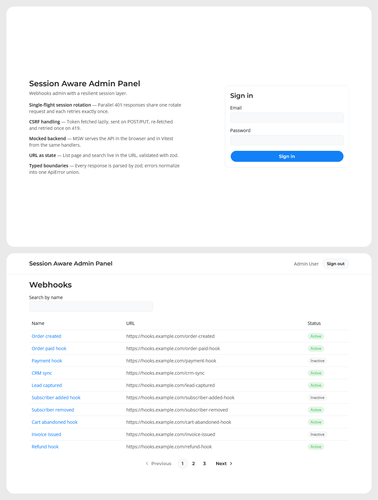

# Session Aware Admin Panel Architecture

> Session rotation, CSRF, single-flight 401 retry

Live demo: https://session-aware-admin-panel.vercel.app



A webhooks admin app (sign in, list with search and pagination, edit form) built to demonstrate a
resilient client-side session layer. The backend is fully mocked in the browser with MSW.

**Stack:** React · TypeScript (strict) · TanStack Router/Query · react-hook-form · zod · MSW · Vitest

## Presentation

[View the presentation](https://notebooklm.link.google/EiiiwQojvLX6)

## Getting started

Requires Node.js `>=22.12` and pnpm.

```bash
pnpm install
pnpm dev
```

The app is served at `http://localhost:5173`.

## Test credentials

- Email: `admin@example.test`
- Password: `password123`

## Tests and checks

```bash
pnpm test
pnpm typecheck
pnpm lint
pnpm build
```

The transport test covers the key scenario: two parallel requests receive `401`, trigger a single
session rotation and both retry successfully. Other tests cover rotation failure, a repeated `401`,
request cancellation, single-flight CSRF fetch and recovery after `419`.

## Key decisions

Rules and rationale live in the [constitution](.specify/memory/constitution.md),
[`research.md`](specs/001-webhooks-admin-app/research.md) and
[`contracts/http-client.md`](specs/001-webhooks-admin-app/contracts/http-client.md).

- **Transport/session.** One framework-agnostic HTTP client owns `fetch`, CSRF, `401`/`419`,
  single-flight rotation and the single retry. UI and TanStack Query never duplicate this logic.
- **URL state.** `page` and `search` live only in the URL and are validated with zod. Search is
  debounced with `replace`, pagination uses `push`.
- **Typed boundaries and errors.** All API responses are validated with zod, types come from
  `z.infer`, and errors are normalized into a discriminated `ApiError` union.
- **Token storage.** `device_session_token` exists only as a local variable during sign-in;
  `localStorage` holds only `fingerprint`. The mocked MSW session is kept in memory.
- **`422` handling.** Server errors map to form fields via `setError`, unknown fields to `root`.
  `401`/`419` belong to the transport; `404` and other errors to their own screens.

## Limitations

- After a full page reload you must sign in again: the MSW mock session lives only in the
  browser worker's memory. List params in the URL are preserved.

## Agent workflow

How this was built (spec-driven development with Claude Code):

- **SDD with [Spec Kit](https://github.com/github/spec-kit).** A constitution
  ([`.specify/memory/constitution.md`](.specify/memory/constitution.md)) overrides specs, plans and
  tasks. Artifacts for the feature are in [`specs/001-webhooks-admin-app/`](specs/001-webhooks-admin-app/):
  `spec` → `clarify` → `plan` → `tasks` → `analyze` → `implement`.
- **TDD for the transport layer.** Vitest + MSW node server, no React, no fake timers; each
  guarantee in `contracts/http-client.md` is backed by a test.
- **Superpowers and code review.** `superpowers` (brainstorming, planning, debugging,
  verification) and `code-review` for every change.
- **Process gates.** One GitHub issue per user story, branch per issue, Conventional Commits,
  PR with `Closes #n`, husky pre-commit (lint-staged, typecheck, tests) and required CI checks.

## License

[MIT](LICENSE)
